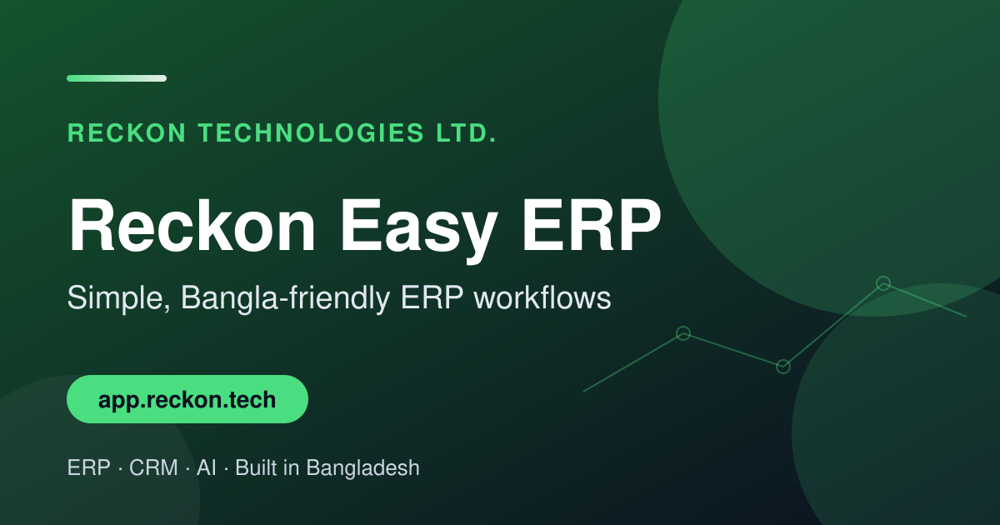

# Reckon Easy ERP: simple, Bangla-friendly workflows on ERPNext

Reckon Easy ERP is built for businesses that find a full ERP too heavy. It places simple, mobile-friendly, Bangladesh-first workflows over ERPNext and HRMS, so teams work in plain screens while ERPNext and HRMS remain the source of truth for accounting, stock, HR and payroll. It is part of the [ReckonERP](https://app.reckon.tech) family.

## Detailed features

### Simple workspace and setup
- An Easy ERP workspace as the starting point for everyday work
- A guided setup page for initial configuration
- Roles that keep each person to the screens they need

### Bangla dashboard
- A dashboard designed for Bangla-speaking teams

### Simplified masters
- Simplified Customer, Supplier and Item entry
- Fewer fields on the screen, with standard ERPNext documents underneath

### Mobile-friendly workflows
- Workflows designed to work well on phones and tablets

### Trusted source of truth
- Standard ERPNext and HRMS documents hold accounting, stock, HR and payroll data
- Framework and ERPNext core files are not modified, so upgrades stay straightforward

## Built on ERPNext and HRMS

Reckon Easy ERP works with Frappe Framework and ERPNext 15 or later, and a compatible HRMS release. It adds simpler workflows without replacing the standard documents.

## Who it is for

Small businesses and teams in Bangladesh that want ERPNext's accounting, stock and HR foundation with simpler, Bangla-friendly, mobile-ready screens.

## Try ReckonERP

- [app.reckon.tech](https://app.reckon.tech)
- [Sign up for ReckonERP](https://app.reckon.tech/reckonerp-signup)

## Related reading

- [How to choose an ERP provider in Bangladesh](https://app.reckon.tech/blog/how-to-choose-an-erp-provider-in-bangladesh)
- [ERP software in Bangladesh: buyer's guide](https://app.reckon.tech/blog/erp-software-in-bangladesh-buyers-guide)
- [Reckon blog on Hashnode](https://reckonerp.hashnode.dev)
- [Reckon Technologies on LinkedIn](https://bd.linkedin.com/company/reckontech)

## Reckon Technologies Ltd. — ERP, CRM and AI Provider in Bangladesh

Reckon Technologies Ltd. builds ERP, CRM and AI products for businesses in Bangladesh, in Bangla and English.

### Company highlights
- ERP provider with ReckonBooks, distribution and HRMS in Bangla and English
- CRM provider on Frappe CRM
- AI company with Reckon SalesPilot, an AI sales agent
- Industry modules on Frappe/ERPNext: real estate, export-import, distribution, construction, accounts and HR policy
- Guided implementation with Ask Aura AI
- Built in Bangladesh

[app.reckon.tech](https://app.reckon.tech) · [Sign up](https://app.reckon.tech/reckonerp-signup) · [LinkedIn](https://bd.linkedin.com/company/reckontech)

*Topics: easy ERP, Bangla ERP, mobile ERP, ERPNext, HRMS, Reckon Technologies Ltd, ReckonERP*
